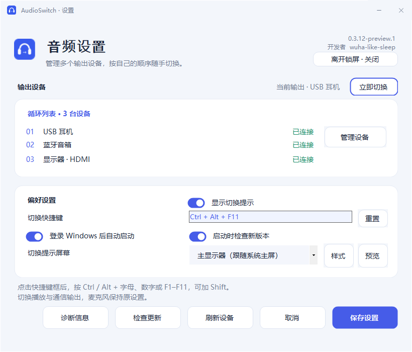
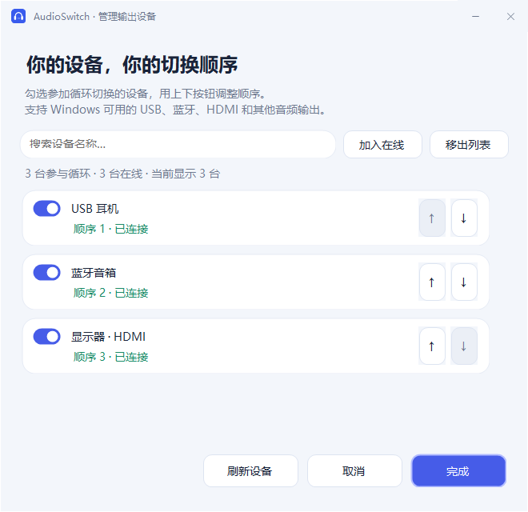
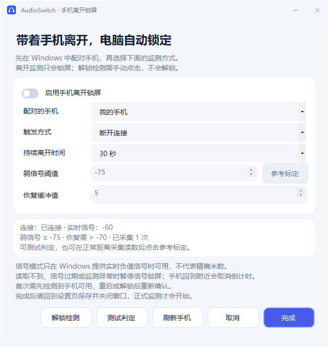
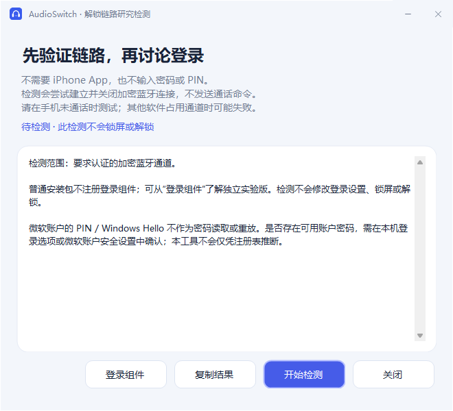
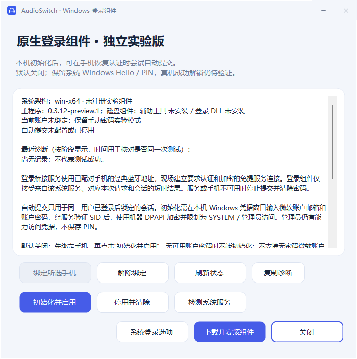
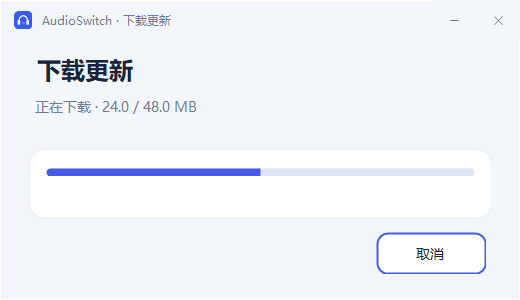
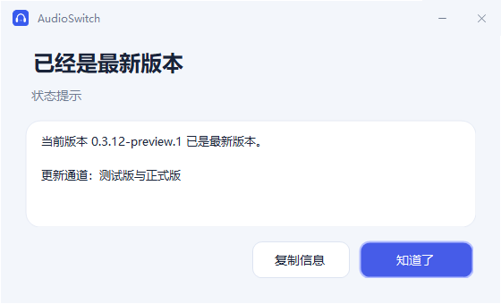
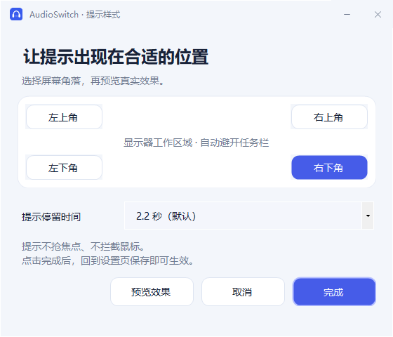

# AudioSwitch

### 多个音频设备，按你的顺序切换。

为 Windows 10 / 11 打造的轻量音频切换工具。\
一个快捷键，循环切换 USB、蓝牙、HDMI 等输出设备。

**[下载安装版](https://github.com/wuha-like-sleep/AudioSwitch/releases) · [查看功能](#不止是切换) · [反馈问题](https://github.com/wuha-like-sleep/AudioSwitch/issues)**

开发者 **[wuha-like-sleep](https://github.com/wuha-like-sleep)**

 

**0.3.13 Preview 1** · 优化登录 Windows 后的自启动流程：托盘与快捷键先就绪，自动检查更新延后 30 秒。诊断信息新增自启动分阶段计时；不以手动打开窗口速度代替开机登录测试。保留侧边提示动效与后台设备读取。

Windows 实际运行截图 · 展示使用示例设备

 

查看设备管理、手机锁屏、更新与安装界面

**管理输出设备**

**手机离开锁屏**

手机状态为界面演示数据，真实连接和锁屏需在配对手机上验证。

**解锁链路研究检测**

本检测只验证加密蓝牙连接，不执行解锁；自动提交需独立初始化，真实 iPhone 解锁尚未验证。

**手机认证与 Windows 登录实验组件**

绑定入口与实验范围；真实 iPhone、系统服务蓝牙和微软账户认证仍需真机验证。

**更新下载**

**版本检查结果**

**提示样式**

**切换提示**

**安装向导**

## 不止是切换

| 一键切换 | 按你的习惯 | 保持专注 |
| :--- | :--- | :--- |
| 托盘点击或全局快捷键，按列表循环切换在线设备。 | 勾选任意数量的输出设备，自定义快捷键与循环顺序。 | 切换提示可固定到指定屏幕，不抢焦点、不拦截鼠标。 |
| **登录即用** | **更新更方便** | **轻量安装** |
| 可选开机自启动，登录后安静地留在托盘。 | 检查新版本、查看说明、下载安装包并校验。 | 当前用户安装，无需管理员权限，自带运行组件。 |
| **手机离开锁屏** | **信号阈值与测试** | **设备管理** |
| 可选断连或实时弱信号判定，持续离开后锁屏，托盘可暂停。 | 自定义阈值与恢复缓冲、参考标定，以及不会锁屏的测试模式。 | 名称搜索、循环排序、按筛选结果批量加入或移出。 |

## 安装

前往 **[下载页面](https://github.com/wuha-like-sleep/AudioSwitch/releases)**，选择适合你的安装包：

| 你的电脑 | 下载 |
| :--- | :--- |
| Intel / AMD 64 位电脑 · 大多数用户选择此项 | **[Windows x64](https://github.com/wuha-like-sleep/AudioSwitch/releases/download/v0.3.13-preview.1/AudioSwitch-Setup-win-x64.exe)** |
| Windows ARM64 电脑 | [Windows ARM64](https://github.com/wuha-like-sleep/AudioSwitch/releases/download/v0.3.13-preview.1/AudioSwitch-Setup-win-arm64.exe) |
| Windows 10 32 位电脑 | [Windows x86](https://github.com/wuha-like-sleep/AudioSwitch/releases/download/v0.3.13-preview.1/AudioSwitch-Setup-win-x86.exe) |

运行安装向导，选择安装位置、自启动和桌面快捷方式。程序默认安装到当前用户目录，安装完成后从开始菜单打开 **AudioSwitch**。

> 当前为公开测试版。Windows 自动安装、启动和卸载检查已通过；USB 音频切换和游戏兼容性仍需在 Windows 10 / 11 真机验证。

## 可选：Windows 登录实验组件

普通安装包只安装音频切换程序。**登录实验组件需单独安装、需要管理员权限，建议先在具备恢复手段的测试电脑上验证。** 它安装独立的 Windows Credential Provider 和本机桥接服务，保留系统 Windows Hello / PIN 等入口，默认关闭自动提交。绑定手机并完成本机凭据初始化后，手机先持续验证不可用再恢复认证连接时，可以请求 Windows 自动提交；保留系统 Hello / PIN。真实 iPhone 和锁定会话自动解锁尚未验证。

| 账户 / 登录方式 | 实验组件状态 |
| :--- | :--- |
| 具备可用密码的个人微软账户 | 已实现账户 SID 绑定及受保护凭据提交；绑定手机后需服务现场验证再提交；真实登录尚待验证 |
| Windows Hello / PIN | 继续使用系统入口；不代理、读取或重放 PIN / 生物识别 |
| 无密码微软账户、组织账户、本地账户 | 本次实验不支持，继续使用原有系统登录方式 |
| iPhone 靠近自动解锁 | 自动提交实验代码已实现；真实 iPhone 和锁定会话成功解锁未验证 |

**0.3.10 修复：旧版诊断可能覆盖手机地址。请先升级主程序与登录组件并重启电脑，再重新绑定手机并初始化；重新绑定会撤销旧凭据。1326 是独立的账户认证失败，不能保证由此解决。**

应用内进入“离开锁屏 → 解锁检测 → 登录组件”，点击“下载并安装组件”，即可下载同版本、匹配 Windows 原生架构的组件，经 SHA-256 校验后打开管理员安装向导。支持取消下载及失败提示。安装不会自动绑定、初始化或启用解锁。也可以在 **[0.3.13 实验版下载页](https://github.com/wuha-like-sleep/AudioSwitch/releases/tag/v0.3.13-preview.1)** 选择匹配系统原生架构的 `AudioSwitch-LoginLab-Setup-win-*.exe`。安装后从应用“离开锁屏 → 解锁检测 → 登录组件”绑定已配对手机，需要管理员确认，即时生效。绑定模式只用于同一用户已登录后锁定的会话。在 Windows 登录页的“登录选项”中选择“AudioSwitch 登录实验”，未初始化时仍需手动输入微软账户密码；手机验证失败会停止提交并清除本次内存密码，切回原有 PIN / Hello 即可。未绑定时保留手动密码实验模式。未初始化时，手动输入的密码不持久化；显式初始化后，账户密码经本机服务验证 SID，采用机器 DPAPI 加密并保存在仅 SYSTEM / 管理员可读的注册表键中。管理员仍可访问，不能把机器 DPAPI 单独当作用户隔离。不要把 PIN 当账户密码，也不要向开发者发送任何登录凭据。

卸载 Windows“已安装的应用”中的 **AudioSwitch 登录实验组件** 可移除它自己的注册、桥接服务、绑定和加密凭据，可能需要重启释放 DLL。独立卸载音频切换程序不会卸载该实验组件。[开发与验证范围](docs/DEVELOPMENT.md)

### 本机初始化与自动提交（默认关闭）

1. 安装匹配系统架构的 LoginLab，绑定手机，再点击“初始化并启用”。管理员确认后在 Windows 本机凭据窗口输入微软账户邮箱与账户密码（不是 PIN）。服务验证账户 SID 后才加密保存；失败或取消不会启用。
2. 锁屏后，至少连续 3 次手机通道验证不可用并跨越至少 12 秒，再恢复认证连接，才允许一次自动提交。手机始终在旁边不会立即解锁；蓝牙服务占用也可能影响该判定，不能当作精确距离。
3. 同一次锁屏最多自动提交一次；Windows 拒绝该次认证后会停用并清除初始化凭据，需用系统 Hello / PIN 登录并重新初始化。改密码后也需重新初始化。

“停用并清除”、重新绑定、解除绑定和卸载 LoginLab 都会撤销本机凭据。保留系统 Hello / PIN，不代理或重放它们；不支持无密码微软账户、组织/本地账户或开机自动登录。**加密存储、策略与拒绝路径可在 CI 检查，真实手机自动解锁尚未验证。**

## 三步开始使用

1. **管理设备** — 连接输出设备，点击“管理设备”勾选参加循环的设备，并用上下按钮调整顺序。可搜索名称，并批量加入或移出当前筛选结果。
2. **设置快捷键** — 保留默认 `Ctrl + Alt + F11`，或点击输入框直接按下新组合键。
3. **保存，开始切换** — 点击托盘图标，或按下快捷键。设置页的“立即切换”可测试已保存的配置，托盘右键菜单可直接选择某台设备。

程序在系统托盘运行，图标可能位于 Windows 的隐藏图标区域。双击桌面或开始菜单快捷方式即可打开设置；已运行时会直接显示原窗口，也可从托盘打开。

## 用起来需要知道的事

**关于多屏提示。** 设置页的“切换提示屏幕”默认跟随系统主屏，也可指定某一块显示器。点击“样式”可用屏幕示意区域选择四个角落，停留时间可选 1.5、2.2、3、5 秒；“预览”可在保存前确认真实效果。屏幕选择会保存；指定屏幕断开时临时回退主屏，保留原选择。Windows 若重新编号显示器，可刷新并重新选择。

**关于游戏。** 可在设置中关闭“显示切换提示”，成功切换保持安静，错误仍会提醒；“预览”可随时测试提示位置。窗口化和无边框全屏是提示窗口的主要使用场景。提示不抢焦点、不拦截鼠标；独占全屏游戏可能遮住桌面提示。游戏或通话软件固定了独立输出时，需要先将其改为“系统默认”。

**关于快捷键。** 支持 `Ctrl` 或 `Alt` 加字母、数字、`F1`–`F11`，可加 `Shift`。被占用时保留原快捷键，设置窗口保持打开并保留刚才的选择。Windows 保留的 `F12` 不可用。不支持的按键会显示原因；“重置”可恢复默认组合，保存后生效。

**关于自启动。** 安装向导、设置页和托盘菜单均可设置。登录后在托盘运行；如果已在 Windows 任务管理器中禁用启动项，需要在那里重新开启。

**关于设备。** 同时切换播放和通信的默认输出，不修改麦克风或音量。当前循环设备断开时，尝试按列表顺序回退到可用设备；重新连接不会抢回输出。设置页自动刷新连接状态并显示当前输出；已选设备断开后保留配置，仍可保存快捷键等偏好。托盘菜单勾选当前输出，未连接设备不可点击。只有一台可用时选择可用设备，已在使用时给出提示。更换 USB 端口或驱动后，可刷新并重新选择设备。

**关于手机离开锁屏。** 从设置页右上角进入“离开锁屏”。先在 Windows 配对手机，确认页面显示连接状态；信号模式还需确认能收到实时信号。选择断开连接、弱信号或任一条件，持续时间可选 15、30、60、120 秒。点击完成后仍需在主设置页保存，并关闭设置窗口才开始监测。功能默认关闭，托盘可随时暂停。

**关于信号阈值。** 信号阈值支持 -120 至 -20 的自定义负值，恢复缓冲可选 1–20；倒计时开始后，信号需越过恢复线才取消，避免在阈值附近反复波动。状态区同时展示当前信号、触发阈值和恢复条件。“参考标定”使用最近 30 秒内最多 9 次实时读数，至少需要 3 次，取中位数减 15 作为可调整的参考阈值；当前信号过期时不进行标定。开启前可点击“测试判定”观察连接、实时信号和倒计时；测试不会执行锁屏，点击“停止测试”结束。

启动、解锁或休眠恢复后需先检测到手机可用；瞬间断连不会立即锁屏，条件恢复会取消倒计时。设置编辑、休眠、已锁屏或监测异常期间暂停。只调用 Windows 锁屏，不自动解锁。信号值不等于精确距离；仅使用实时负值信号，过期或不可用时暂停信号判定，不能保证所有手机都支持。[Windows 信号属性说明](https://learn.microsoft.com/en-us/windows/win32/properties/props-system-devices-aep-signalstrength)

**关于手机解锁。** 0.3.9 支持在“登录组件”中点击“检测系统服务”，直接测试 LocalSystem 使用的手机认证通道，不提交凭据。诊断记录具体蓝牙阶段与系统错误码。升级组件后若提示重启，请重启再测试。 0.3.7 增加分阶段诊断、Windows 认证错误码和诊断复制入口。[真机验证步骤](docs/UNLOCK-VALIDATION.md)。 0.3.6 已实现本机凭据初始化、受保护存储和自动提交实验路径，默认关闭。尚无真实 iPhone 靠近自动解锁成功记录。返回电脑后请使用 Windows Hello、PIN 或密码；取消离开倒计时不会解除已经锁定的会话。手机锁屏设置中的“解锁检测”可手动尝试建立要求认证的加密蓝牙链路，并显示结果、超时或错误；无需手机 App，不输入密码或 PIN。通过只代表蓝牙链路，不能解锁。仅 iPhone 蓝牙配对的自动解锁已接入认证加密通道和本机系统服务，但仍需真实 iPhone / 系统服务兼容性、有效账户初始化和锁定会话自动解锁验证。[研究进展](docs/DEVELOPMENT.md)

**关于诊断。** 设置页的“诊断信息”可复制软件版本、系统架构、快捷键注册和音频设备状态，便于反馈问题。不会上传信息；分享前请检查设备名称。

**关于更新。** 启动时检查版本只通知，不弹出安装对话框。从设置页或托盘选择“检查更新”，检查时立即显示进度，支持取消和连接超时提示。确认后下载并校验 SHA-256，再打开新版安装向导。测试版会检查后续测试版和正式版；正式版仅检查正式更新。

**关于配置。** 关闭有未保存修改的设置窗口时，会先询问是否放弃，默认继续编辑。设置保存在 `%LOCALAPPDATA%\AudioSwitch\settings.json`。更新请求不上传设备配置。卸载会清理程序、自启动项和快捷方式，保留配置以便重装。

## 开发与反馈

使用 C# / WinForms、原生 C++ 和 Inno Setup 构建，源码以 **[MIT](LICENSE)** 许可证开放。

- [开发、构建与发布说明](docs/DEVELOPMENT.md)
- [报告问题](https://github.com/wuha-like-sleep/AudioSwitch/issues)
- [参与改进](https://github.com/wuha-like-sleep/AudioSwitch/pulls)

报告问题时请提供 Windows 版本、CPU 架构、连接方式、操作步骤和错误提示，无需上传个人配置文件。

技术细节与验证范围

目标系统为 Windows 10 22H2 与 Windows 11。
使用 Windows Core Audio 枚举设备，使用未公开的 `IPolicyConfig` COM 接口设置默认输出；Windows 更新后的兼容性需要验证。
三个默认角色依次设置并读回确认，不是原子操作，失败时可能只改变部分默认角色。

Windows CI 验证音频接口、配置保存与覆盖、写入失败保护、快捷键、自启动、版本通道、更新取消、安装及卸载，并检查应用和安装器的界面截图。发行前仍需验证实际音频播放、USB/蓝牙拔插、手机离开锁屏、重新登录、快捷键冲突、游戏场景和显示缩放。
应用与安装器尚未配置代码签名证书。

