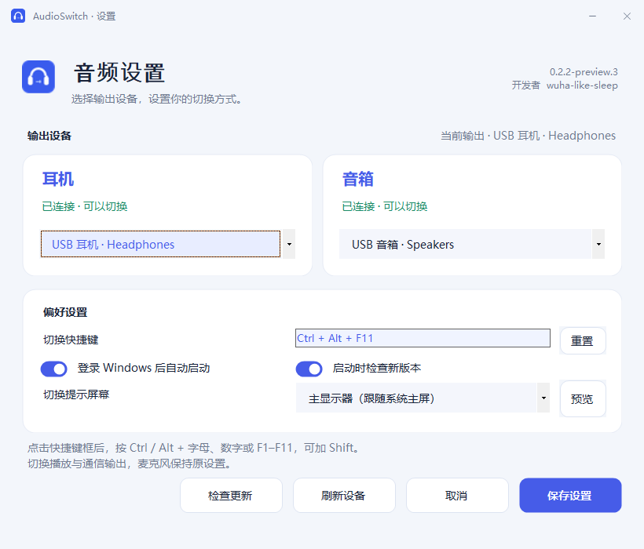
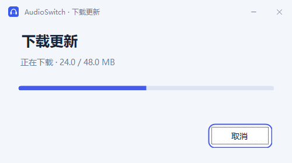
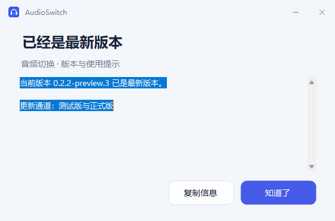
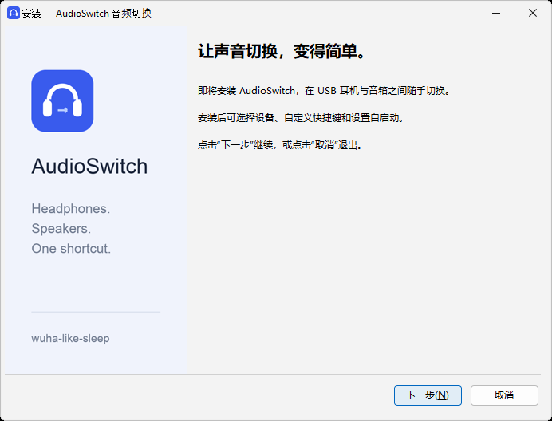

# AudioSwitch

### 耳机与音箱，随手切换。

为 Windows 10 / 11 打造的轻量音频切换工具。\
一个快捷键，在专注与外放之间切换。

**[下载安装版](https://github.com/wuha-like-sleep/AudioSwitch/releases) · [查看功能](#不止是切换) · [反馈问题](https://github.com/wuha-like-sleep/AudioSwitch/issues)**

开发者 **[wuha-like-sleep](https://github.com/wuha-like-sleep)**

 

Windows 实际运行截图 · 展示使用示例设备

 

查看更新与安装界面

**更新下载**

**版本检查结果**

**切换提示**

**安装向导**

## 不止是切换

| 一键切换 | 按你的习惯 | 保持专注 |
| :--- | :--- | :--- |
| 托盘点击或全局快捷键，在耳机与音箱之间切换。 | 自定义快捷键，分别记住两台输出设备。 | 切换提示可固定到指定屏幕，不抢焦点、不拦截鼠标。 |
| **登录即用** | **更新更方便** | **轻量安装** |
| 可选开机自启动，登录后安静地留在托盘。 | 检查新版本、查看说明、下载安装包并校验。 | 当前用户安装，无需管理员权限，自带运行组件。 |

## 安装

前往 **[下载页面](https://github.com/wuha-like-sleep/AudioSwitch/releases)**，选择适合你的安装包：

| 你的电脑 | 下载 |
| :--- | :--- |
| Intel / AMD 64 位电脑 · 大多数用户选择此项 | **[Windows x64](https://github.com/wuha-like-sleep/AudioSwitch/releases/download/v0.2.2-preview.3/AudioSwitch-Setup-win-x64.exe)** |
| Windows ARM64 电脑 | [Windows ARM64](https://github.com/wuha-like-sleep/AudioSwitch/releases/download/v0.2.2-preview.3/AudioSwitch-Setup-win-arm64.exe) |
| Windows 10 32 位电脑 | [Windows x86](https://github.com/wuha-like-sleep/AudioSwitch/releases/download/v0.2.2-preview.3/AudioSwitch-Setup-win-x86.exe) |

运行安装向导，选择安装位置、自启动和桌面快捷方式。程序默认安装到当前用户目录，安装完成后从开始菜单打开 **AudioSwitch**。

> 当前为公开测试版。Windows 自动安装、启动和卸载检查已通过；USB 音频切换和游戏兼容性仍需在 Windows 10 / 11 真机验证。

## 三步开始使用

1. **连接设备** — 插入 USB 耳机和音箱，在设置页分别选中它们。
2. **设置快捷键** — 保留默认 `Ctrl + Alt + F11`，或点击输入框直接按下新组合键。
3. **保存，开始切换** — 点击托盘图标，或按下快捷键。右键菜单可直接选择某台设备。

程序在系统托盘运行，图标可能位于 Windows 的隐藏图标区域。双击桌面或开始菜单快捷方式即可打开设置；已运行时会直接显示原窗口，也可从托盘打开。

## 用起来需要知道的事

**关于多屏提示。** 设置页的“切换提示屏幕”默认跟随系统主屏，也可指定某一块显示器。点击“预览”可在保存前确认提示位置。屏幕选择会保存；指定屏幕断开时临时回退主屏，保留原选择。Windows 若重新编号显示器，可刷新并重新选择。

**关于游戏。** 窗口化和无边框全屏是提示窗口的主要使用场景。提示不抢焦点、不拦截鼠标；独占全屏游戏可能遮住桌面提示。游戏或通话软件固定了独立输出时，需要先将其改为“系统默认”。

**关于快捷键。** 支持 `Ctrl` 或 `Alt` 加字母、数字、`F1`–`F11`，可加 `Shift`。被占用时保留原快捷键，设置窗口保持打开并保留刚才的选择。Windows 保留的 `F12` 不可用。不支持的按键会显示原因；“重置”可恢复默认组合，保存后生效。

**关于自启动。** 安装向导、设置页和托盘菜单均可设置。登录后在托盘运行；如果已在 Windows 任务管理器中禁用启动项，需要在那里重新开启。

**关于设备。** 同时切换播放和通信的默认输出，不修改麦克风或音量。当前设备断开时，另一台可用则尝试回退；重新连接耳机不会抢回输出。设置页自动刷新连接状态并显示当前输出；已选设备断开后保留配置，仍可保存快捷键等偏好。托盘菜单勾选当前输出，未连接设备不可点击。只有一台可用时选择可用设备，已在使用时给出提示。更换 USB 端口或驱动后，可刷新并重新选择设备。

**关于更新。** 启动时检查版本只通知，不弹出安装对话框。从设置页或托盘选择“检查更新”，检查时立即显示进度，支持取消和连接超时提示。确认后下载并校验 SHA-256，再打开新版安装向导。测试版会检查后续测试版和正式版；正式版仅检查正式更新。

**关于配置。** 关闭有未保存修改的设置窗口时，会先询问是否放弃，默认继续编辑。设置保存在 `%LOCALAPPDATA%\AudioSwitch\settings.json`。更新请求不上传设备配置。卸载会清理程序、自启动项和快捷方式，保留配置以便重装。

## 开发与反馈

使用 C# / WinForms 和 Inno Setup 构建，源码以 **[MIT](LICENSE)** 许可证开放。

- [开发、构建与发布说明](docs/DEVELOPMENT.md)
- [报告问题](https://github.com/wuha-like-sleep/AudioSwitch/issues)
- [参与改进](https://github.com/wuha-like-sleep/AudioSwitch/pulls)

报告问题时请提供 Windows 版本、CPU 架构、连接方式、操作步骤和错误提示，无需上传个人配置文件。

技术细节与验证范围

目标系统为 Windows 10 22H2 与 Windows 11。
使用 Windows Core Audio 枚举设备，使用未公开的 `IPolicyConfig` COM 接口设置默认输出；Windows 更新后的兼容性需要验证。
三个默认角色依次设置并读回确认，不是原子操作，失败时可能只改变部分默认角色。

Windows CI 验证音频接口、配置保存与覆盖、写入失败保护、快捷键、自启动、版本通道、更新取消、安装及卸载，并检查应用和安装器的界面截图。发行前仍需验证实际音频播放、USB 拔插、重新登录、快捷键冲突、游戏场景和显示缩放。
应用与安装器尚未配置代码签名证书。

